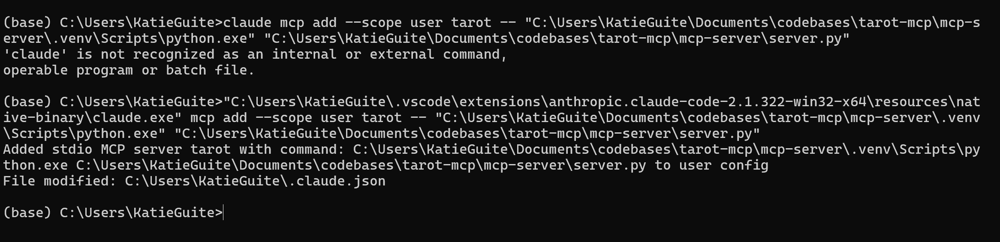
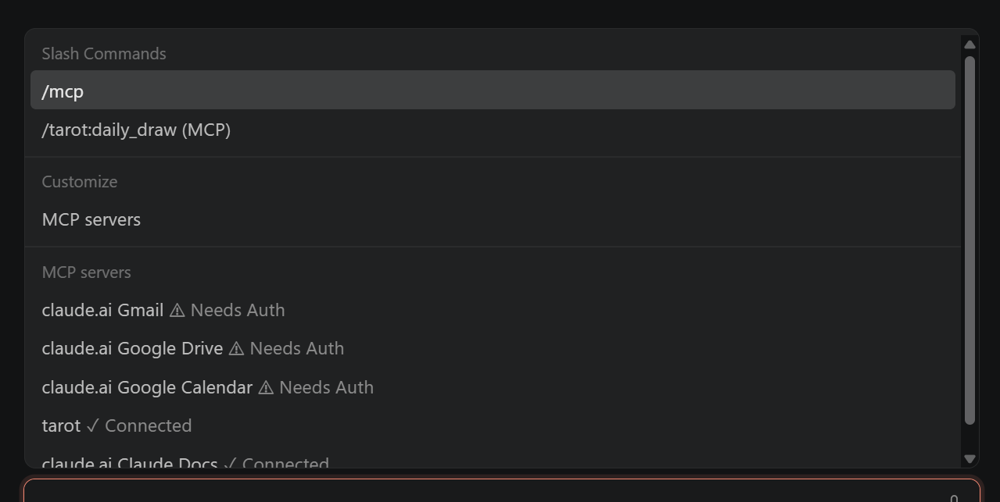
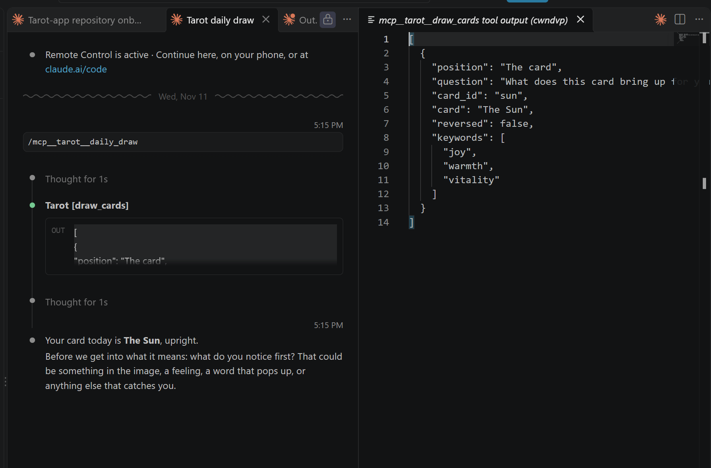

# Steps

A log of how this project was built, one step at a time, with the why behind each choice.
Commands are for cmd on Windows.

## 1. Git and GitHub

**What:** a local git repo in `codebases\tarot-mcp`, connected to a private GitHub repo,
`katie-guite/tarot-mcp`.

The usual commands for this:

```
cd C:\Users\KatieGuite\Documents\codebases\tarot-mcp
git init
git remote add origin https://github.com/katie-guite/tarot-mcp.git
git add .
git commit -m "Add tarot app prototype and data"
git push -u origin main
```

**Layout:** the repo root holds `CLAUDE.md` and this file. The app lives in `tarot-app/`. Later
projects (the MCP server, Supabase migrations) get their own folders beside it, so the root
doesn't fill up with one project's files.

**Fixing a typo in the repo name.** The repo started out as `tarot-mpc`.
- Rename it on GitHub under Settings. GitHub forwards the old address to the new one, but
  don't rely on that.
- Point the local repo at the new address:
  `git remote set-url origin https://github.com/katie-guite/tarot-mcp.git`
- Check it: `git remote -v`
- Rename the local folder too. Close VS Code first, because Windows won't rename a folder
  that's open.

**Getting out of Vim.** `git commit` without `-m` opens Vim to ask for a message.
1. Press `Esc`, then `gg` to jump to the top line.
2. Press capital `O` to open a new line above it, then type the message.
   (Lowercase `i` would type onto the `#` comment line, which git ignores.)
3. Press `Esc`, type `:wq`, and press Enter to save and commit.
   To cancel instead: `Esc`, then `:q!`, then Enter.

To skip Vim next time, use `git commit -m "message"`, or make VS Code git's editor:
`git config --global core.editor "code --wait"`

**Branches.** Each change gets a branch and a PR. `main` holds only finished work.

```
git switch -c vite-setup
```

## 2. Vite + React + TypeScript

**What:** a starter app in `tarot-app/`, built from Vite's `react-ts` template.

**Why Vite:** it serves the app instantly while you work and reloads the page when a file is
saved. `npm run build` bundles it into plain files any host can serve.

**The catch:** `tarot-app/` already held `data/` and `prototype/`. The scaffolder's
`--overwrite` option deletes everything in a folder that isn't empty, so don't use it here.
Instead, create the template in an empty folder, check it, then copy it in:

```
cd %TEMP%
npm create vite@latest tarot-app -- --template react-ts --no-interactive --no-immediate
```

Check the generated files for names that clash with existing ones, then copy them all into
`tarot-mcp\tarot-app`, including the hidden `.gitignore` and `.oxlintrc.json`.

Then install the packages and check that it builds:

```
cd C:\Users\KatieGuite\Documents\codebases\tarot-mcp\tarot-app
npm install
npm run build
```

**What the template added:**

| File | Does |
| --- | --- |
| `package.json` | Lists the packages and the scripts: `dev`, `build`, `lint`, `preview` |
| `package-lock.json` | Pins the exact version of every package, so every install matches. Commit it. |
| `index.html` | The one page. Loads `src/main.tsx`. |
| `src/main.tsx` | Mounts the `App` component into the page |
| `src/App.tsx`, `App.css`, `index.css` | The demo counter page, to be replaced |
| `vite.config.ts` | Vite settings. For now, only the React plugin. |
| `tsconfig*.json` | TypeScript settings: one for the app code, one for config files like `vite.config.ts` |
| `.oxlintrc.json` | Settings for Oxlint, the linter (`npm run lint`) |
| `.gitignore` | Leaves out `node_modules` (installed packages) and `dist` (build output) |

**Run it:**

```
npm run dev
```

Open the address it prints, usually http://localhost:5173. To try it on a phone on the same
Wi-Fi, run `npm run dev -- --host` and open the Network address.

**Versions used:** Node 22.21.1, npm 10.9.4, create-vite 9.3.4, Vite 8.3.7, React 19,
TypeScript 7.

## 3. Clear the template and type the data

**Clear the demo.** Delete `src/assets/` (the Vite and React logos and the hero image),
`src/App.css`, and `public/` (the favicon and icons). Remove the favicon line from
`index.html`. The app gets its real icon when it becomes a PWA. Replace the template's
`README.md` with a short one: what the app is, the commands, and where things live.

`App.tsx` becomes a single heading plus a line that counts the loaded cards and spreads. It's a
quick check that the data imports work. `index.css` now holds the prototype's color tokens,
light and dark.

**Move the data.** Move the JSON files from `tarot-app/data/` to `tarot-app/src/data/`. Vite
only processes files under `src/` that something imports, so this is where data the app
uses belongs.

**Types.** `src/data/types.ts` describes the shape of each file:

| Type | File |
| --- | --- |
| `Card` (`MajorCard` or `MinorCard`), `CardDetail`, `Keywords` | `cards.json` |
| `Suit` | `suits.json` |
| `Rank` | `ranks.json` |
| `JourneyRow` | `journey.json` |
| `ArcanaInfo` | `arcana.json` |
| `Spread`, `SpreadPosition` | `spreads.json` |

`Card` is a **union**: either a `MajorCard` (has `number`) or a `MinorCard` (has `suit`,
`rank`, `combined`). The `arcana` field tells them apart. Inside
`if (card.arcana === 'minor')`, TypeScript knows the card has a `suit`. Outside it,
`card.suit` is an error. That catches the "this card has no suit" mistakes at build time
instead of on the phone.

**One import point.** `src/data/index.ts` imports each JSON file and exports it with its type:
`CARDS`, `SPREADS`, `SUITS`, `RANKS`, `JOURNEY`, `ARCANA`. The rest of the app imports from
`./data`, never from the JSON files directly.

Why the `as Card[]` cast: TypeScript reads `"arcana": "major"` in a JSON file as any string,
not the exact value `'major'`, so the JSON doesn't match `Card` on its own. The cast says
"trust me, it does." That trust is the weak spot: if the JSON drifts from the types, nothing
complains. It's acceptable here because the JSON is hand-written and moves to Supabase later.

**Check:**

```
npm run build
npm run lint
npm run dev
```

The page should say "17 cards and 5 spreads loaded."

## 4. An MCP server with one tool

**What:** `mcp-server/`, a small Python program with one tool, `get_card`, that reads
`tarot-app/src/data/cards.json`. It's a separate project from the app, with its own
`requirements.txt` and `.venv`.

**Why Python, when the app is TypeScript:** to use what work uses. speak_friend is a Python MCP
server on the same package (`mcp==2.3.0`), and daedalus defines tools with pydantic. Everything
learned here carries over line for line. The app and the server share only the JSON files.

**How MCP works.** Think of the server as a kitchen, and Claude as a waiter who can only read
the menu.
- **The menu** is the tool list: each tool's name, description, and inputs. That's all Claude
  sees. It never sees the code.
- **The order:** Claude picks a tool that fits the question and calls it with arguments.
- **The kitchen** is the function that runs and sends back a result. Claude writes its answer
  from that result.
- **A bad menu gets bad orders.** A vague description means the wrong tool or the wrong
  arguments, even when the code is fine.

**The client** (Claude Desktop, Claude Code, or the Inspector) starts the server as a background
program and talks to it over stdin and stdout, one JSON message per line. This is the
**stdio transport**. There are three messages:

| Message | Means |
| --- | --- |
| `initialize` | Handshake: protocol version, and what each side supports |
| `tools/list` | "Show me the menu." The server answers with each tool's name, description, and input schema. |
| `tools/call` | "Run `get_card` with `{ "id": "moon" }`." The server answers with `content`. |

**Gotcha:** stdout *is* the conversation, so `print()` in the server corrupts it. Log to
stderr instead.

**Setup:**

```
git switch main
git pull
git switch -c mcp-server
mkdir mcp-server
cd mcp-server
C:\Users\KatieGuite\anaconda3\envs\dev310\python.exe -m venv .venv
.venv\Scripts\python.exe -m pip install -r requirements.txt
```

- `requirements.txt` pins `mcp==2.3.0`, the same as speak_friend. It brings pydantic with it.
- `.venv` is this project's own Python, made from dev310, the way speak_friend's README does it.
  `.gitignore` leaves it out.

**The code,** `server.py`, has three parts:
1. Read `cards.json` once at startup. The path is built from `__file__`, so it's relative to
   the file, not to the folder the server is started from.
2. `mcp = MCPServer(name='tarot')`
3. A plain Python function with `@mcp.tool()` on top. The SDK builds the menu from it:
   - the function name is the tool name
   - the docstring is the description
   - each argument becomes an input, and `Annotated[str, Field(description=...)]` (pydantic)
     gives it a description on the menu
   - the return value is the result

If the id doesn't exist, the function raises `ToolError` with the list of valid ids. The SDK
turns that into a result with `isError: true`. Claude reads it and can retry with the right
id, so a good error message is part of the menu too.

**Check it raw.** Send it the messages directly (Git Bash):

```
printf '%s\n' \
'{"jsonrpc":"2.0","id":1,"method":"initialize","params":{"protocolVersion":"2025-11-25","capabilities":{},"clientInfo":{"name":"test","version":"0"}}}' \
'{"jsonrpc":"2.0","method":"notifications/initialized"}' \
'{"jsonrpc":"2.0","id":2,"method":"tools/list"}' \
'{"jsonrpc":"2.0","id":3,"method":"tools/call","params":{"name":"get_card","arguments":{"id":"moon"}}}' \
'{"jsonrpc":"2.0","id":4,"method":"tools/list"}' \
| .venv/Scripts/python.exe server.py
```

The answer to `tools/list` is exactly what Claude would see: the function's signature has
become JSON Schema. The last request is a spare: the pipe closes as soon as the input ends,
and the server can be cut off before its last reply.

**Lesson: the result was being sent twice.** With `-> str` on the function, the SDK guesses
you want "structured output" and sends the result twice: once as `content` and again as
`structuredContent`, plus an `outputSchema` on the menu. `@mcp.tool(structured_output=False)`
turns that off. The card reply dropped to about half its size (1,184 bytes). speak_friend's
`get_demand` has the same `-> str` and plain `@mcp.tool()`, so it is worth checking there.

**Check it in the Inspector** (cmd, from `mcp-server`):

```
npx @modelcontextprotocol/inspector .venv\Scripts\python.exe server.py
```

**What the Inspector is:** Postman for MCP. It plays the client, so you can make requests by
hand and see the exact JSON, with no AI involved. Unlike Postman, it also speaks the protocol
for you: it does the handshake, wraps each request in its envelope (`jsonrpc`, `id`,
`method`, `params`), and matches replies by `id`. You only say which tool and what input.

| REST (speak_friend) | MCP (tarot) |
| --- | --- |
| Postman, or FastAPI's `/docs` page | The MCP Inspector |
| `/openapi.json`: every endpoint and its inputs | `tools/list`: every tool, description, and input schema |
| `GET /get_demand` | `tools/call` with `get_card` and `{"id": "moon"}` |

**Using it** (Inspector 2026 layout):
1. The page shows a `python.exe` card with the command. Flip its toggle to connect. The top bar
   shows the server's name (`tarot`, from `MCPServer(name='tarot')`) and the protocol version
   both sides agreed on (`MCP 2025-11-25`).
2. The Messages panel on the right is the whole conversation, newest first, so read it from the
   bottom: `initialize`, `notifications/initialized`, then the Inspector asks for all three
   menus by itself: `tools/list`, `prompts/list`, `resources/list`. Prompts and resources come
   back empty, since this server only has a tool.
3. Expand `tools/list` (the arrows icon) to see the raw menu.
4. Open the Tools tab, pick `get_card`, enter `moon`, and run it. A `tools/call` message
   appears at the top of the panel. Try `the-moon` to see the error.

The long `MCP_INSPECTOR_API_TOKEN` in the address bar is a password for that session. Keep it
out of screenshots you share.

**Claude Desktop: skipped for now.** A stdio server is added to Claude Desktop through a config
file, normally reached from Settings, then Developer. This version of Claude Desktop
(3.6556.1) has no Developer menu, only Customize (Connectors, Skills, Plugins). So the plan is
the remote route instead: once the server speaks HTTP, add its URL with "+ Add" under
Connectors. That's also how speak_friend is reached, so it's the more useful one to learn.

**No API tokens needed.** The server makes no AI calls, and Claude Desktop runs on the
claude.ai account. API tokens come later, when the app calls Claude itself.

**At work: daedalus does all of this in one process.** MCP splits three jobs that daedalus
(`src/ai/anthropic_model.py`) does itself:

| Job | With MCP | In daedalus |
| --- | --- | --- |
| The app you chat in | Claude Desktop | `run_streamlit_app` |
| The loop: ask Claude, run tools, repeat | Built into Claude Desktop | `_run_tool_loop` |
| The menu | The server's `tools/list` reply | `_build_anthropic_tools`: function name, description, pydantic schema |
| The kitchen | The server's tool handler | The app's Python function, called by `_dispatch_tool` |

So daedalus uses plain tool use through the Anthropic SDK, with no MCP. The menu is built the
same way: a name, a description, and a pydantic schema.

**The same server in TypeScript** is kept in `mcp-server-ts/` (the TypeScript MCP SDK, with zod
in place of pydantic). It was built first, then replaced to match work. Comparing the two shows
what is the protocol and what is just one SDK's style: the messages are identical, and only the
way you declare a tool differs.
daedalus also prompt-caches the system prompt and messages and logs tokens per turn, which is
the pattern to copy when tarot calls Claude itself.

## 5. Test the tool with pytest

The Inspector is checking by hand. A test checks the same thing every time, in under a second.

**Setup.** pytest goes in `requirements.txt` (pinned to `9.1.1`, the same as speak_friend), then:

```
cd mcp-server
.venv\Scripts\python.exe -m pip install -r requirements.txt
.venv\Scripts\python.exe -m pytest tests -q
```

Run it from `mcp-server/` with `python -m pytest`, not plain `pytest`. `python -m` puts the
current folder on the import path, so the test can `import server`. speak_friend runs its tests
the same way. pytest leaves a `.pytest_cache` folder behind, so it's in `.gitignore`.

**The trick: test through MCP, not around it.** The SDK's `Client` usually takes a URL or a
command. In tests it can take the server object itself and run it in-process:

```python
async with Client(mcp) as client:
    result = await client.call_tool('get_card', {'id': 'moon'})
```

That's the same `tools/list` and `tools/call` Claude sends, with no subprocess and no Inspector.
Calling `get_card('moon')` directly would test the kitchen but not the menu or the reply shape.

**The three tests** (`mcp-server/tests/test_server.py`):

| Test | Checks |
| --- | --- |
| The menu | `tools/list` has `get_card`, its description, and `id` as a required input |
| A good call | `moon` comes back once, as text, and its name is The Moon |
| A bad call | `the-moon` comes back with `is_error` set, and the text lists the valid ids |

"Once" is the test for the "result sent twice" lesson in step 4. Without
`structured_output=False` the reply still has one content block but gains a `structuredContent`
copy, so the test checks `structured_content` is empty, not just the block count. To see it
bite, delete `structured_output=False` from `server.py`, rerun, watch that test fail, and put it
back.

**Field names in Python are snake_case.** The wire says `isError` and `inputSchema`; the SDK's
Python objects say `is_error` and `input_schema`.

**At work.**

| | tarot | speak_friend | demand_scenarios |
| --- | --- | --- | --- |
| Test file | `mcp-server/tests/test_server.py` | `tests/test_mcp.py` | `tests/` |
| What it tests | The tool, through MCP | The token check only, no tool call | The tool wrappers |
| How it stays offline | `Client(mcp)` in-process | A fake Auth0 key (`tests/fake_auth0.py`) | The HTTP client is replaced |
| Run | `python -m pytest tests -q` | `python -m pytest` | `python -m pytest tests -q` |

speak_friend has no test that calls `get_demand` through MCP. This pattern would be the one to
add there.

## 6. Two more tools: list_spreads and draw_cards

One tool gives Claude nothing to choose. With three, "do a past, present, future reading" means
Claude reads the menu, calls `list_spreads` if it needs the id, then calls `draw_cards`.

**list_spreads** takes no input and returns each spread's id, name, summary and position names.
It was planned as `get_spread(id)`, but Claude's first question is "which spreads are there", and
the positions come back with the draw anyway.

**draw_cards(spread_id)** works like a reading at a table:

1. Find the spread in `spreads.json`. Its `positions` list is the spots, in order (Past, Present,
   Future). It says how many cards and what each spot means, not how they're laid out. Layout is
   the app's job.
2. Deal: `rng.sample(CARDS, len(positions))` picks that many different cards, like dealing from
   a real deck. No card comes up twice.
3. Pair them: `zip(positions, cards)` joins them like a zipper, one pair at a time. Past gets the
   first card, Present the second.
4. Flip a weighted coin per card: `rng.random()` is a number from 0 to 1, and under 0.25 means
   reversed. About 1 card in 4, matching the prototype.
5. Send back each position, its question, the card, reversed or not, and only the keywords for
   that side.

`rng` is `random.SystemRandom()`, which asks the operating system for random numbers, like
`crypto.getRandomValues` in the prototype.

**The code draws the cards, never the model.** A model is bad at being random and might pick
cards that fit the question. Claude asks for a draw and reads what came up.

**Testing something random.** You can't check which cards come up, only what's always true:

| Test | Checks |
| --- | --- |
| list_spreads | The spreads come back in order, with their positions |
| A full draw | A Celtic Cross has 10 cards, in position order, all different |
| A reversed draw | With the random number pinned to 0, the card is reversed and has the reversed keywords |
| A bad spread id | `three-card` is an error that lists the valid ids |

Pinning uses pytest's `monkeypatch`: for one test, `rng.random` is swapped for a function that
always returns 0. That gives a repeatable draw without adding a seed input to the tool, which
Claude would see on the menu and might start filling in.

**At work.** demand_scenarios has the same rule as "the code draws": every number comes from
`lb_database_api`, and the model never computes one. If you find yourself computing a figure in
the chat app, you're in the wrong repo. Here, if the model is picking cards, the tool is missing.

## 7. A prompt and a resource: who decides

An MCP server can offer three kinds of things. The difference is who decides to use each one.

| | Who decides | Restaurant | Ours |
| --- | --- | --- | --- |
| Tool | Claude | A dish Claude orders | `get_card`, `list_spreads`, `draw_cards` |
| Resource | You or the app | Reading material on the table | `tarot://waite/{id}` |
| Prompt | You | The set menu | `daily_draw` |

The same data can go through any of the three. A list of journal questions could be a resource
you attach, a tool Claude calls mid-reading, or a prompt you start. Pick by who should decide.

**The prompt: daily_draw.** `@mcp.prompt()` on a function that returns a string. The string
becomes a message to Claude, with your question filled in: draw one card, say only its name,
ask for your first impression, wait, then talk starting from what you wrote. Step 3 is why it's
a prompt. A tool can only hand back data; it can't make Claude wait. "Hold back the meaning" is
an instruction, and a prompt is how a server gives Claude instructions you chose. It came from a
journal's morning loop: first impression before the meaning.

In the Inspector: the Prompts tab, pick `daily_draw`, type a question, and see the message.
The Inspector shows the message, not the conversation. Seeing Claude wait needs Claude Desktop.

**The resource: Waite's own words.** `waite.json` holds Waite's *Pictorial Key to the Tarot* for
our 17 cards, copied exactly from Wikisource (public domain, credited with a link): what the
picture shows, then upright and reversed. `@mcp.resource('tarot://waite/{id}')` serves one card.

- **`{id}` makes it a template:** one recipe for 17 resources. It's listed under resource
  templates, not resources, and the client fills in the id (`tarot://waite/moon`).
- **A resource error goes to the app, not Claude.** `get_card` with a bad id returns an error
  Claude reads and can fix. `tarot://waite/the-moon` raises a protocol error the client app has
  to handle. That fits: you picked it, so you get the error.
- **Waite is source material, not the app's voice.** His meanings are often bleak or dated
  ("hidden enemies"). The app writes its own. His picture descriptions are useful as the list
  of what is on each card, for `symbols.json`.

**Getting the text.** Claude's web reader summarizes long pages instead of quoting them, so the
two Wikisource pages came through Wikipedia's public API as HTML, and a scratch script pulled
the text out. The only change is rejoining sentences split at the book's page breaks.

**Testing.** Same `Client(mcp)` pattern: `list_prompts`, `get_prompt`, `list_resource_templates`,
`read_resource`. One gotcha: the bad-id resource test catches the error inside `async with
Client(...)`. If it escapes, it comes out wrapped in an `ExceptionGroup` and `pytest.raises`
misses it.

**At work.** speak_friend only has a tool, which fits: Claude decides when it needs demand
numbers. A resource would suit fixed reference material someone attaches on purpose, like a
glossary. A prompt would suit a check that should always run the same way, like a monthly demand
review. Prompts are the closest MCP gets to Skills: a saved recipe you start on purpose.

## 8. The data shape, then all 78 cards

Branch `data-shape`. The goal: settle what a card looks like on a few cards, then fill the deck
once, in the final shape.

**Symbols link the cards.** "Other cards with pillars" was impossible: each card's details had
made-up ids, so nothing said the High Priestess's pillars and the Hierophant's were the same
thing. Now `symbols.json` lists what appears in card pictures (64 so far: pillars, dog, water,
blindfold...), and cards point to them by id. Two levels:

| Field | Holds | Used for |
| --- | --- | --- |
| `card.symbols` | Everything in the picture | `find_cards` |
| `detail.symbols` | What one tappable spot shows ("the dog and the wolf" is two) | The app's tap targets |

The symbol lists come from Waite's own descriptions of the 1909 pictures (Part 2 for Majors,
Part 3 for Minors; his Part 1 describes older decks, so it was skipped), plus a look at the art
where his text is thin. Some links that fell out: pillars on the High Priestess, Hierophant,
Justice and Death; a blindfold on the Two and Eight of Swords; scales on Justice and the Six of
Pentacles.

**find_cards.** Filters by `symbol`, `suit` and `rank`, and they combine. With a symbol, the reply
includes its summary. This is "push filtering into the API": Claude asks for the pillars cards and
gets four, instead of reading 78 and maybe missing one. `suit` is a `Literal` of the four suits,
so the allowed values are on the menu before Claude calls.

**Shape first, on three cards.** The Moon (a Major with no person), the Seven of Wands (a numbered
Minor) and the Queen of Cups (a new court card) got every new field: `summary`, `meaning` (upright
and reversed paragraphs), `advice`, `affirmation`, `as_a_person`, and `facing`. Court ranks 11 to
14 were added to `ranks.json`. Then the other cards got real keywords, themes, prompts and symbols,
and placeholders ("Two of Wands placeholder summary.") in the long fields, so the whole shape works
now and the wording can come later. `facing` is read off the art, so it stays null until checked.

**Tests that check the data, not the code.** Symbol ids are typed by hand, so a test checks that
every id a card uses exists, every detail's symbols are on its card, and every symbol is used.
Others check there are 78 cards with every field, and that each card has Waite's text. A typo like
`pilars` would otherwise just quietly drop a card from every search.

**Scripts for bulk edits.** Adding fields to 78 cards by hand is 78 chances to slip, so small
scripts in the session scratchpad did it, keeping the files' formatting and key order. The
scripts are throwaway; the data and its tests are what's kept.

**At work.** The demand lookup in demand_scenarios takes `group_by`, `columns` and `filters` so the
API does the filtering, the same idea as `find_cards`. And "test the data" is the habit behind
checking a figure against the database: the code can be right and the data still wrong.

## 9. Facing and pose, read off the art

Two facts about each card's main figure, taken from the 1909 Roses & Lilies scans on Wikimedia
Commons (downloaded to a scratch folder and tiled 8 to a sheet to look through quickly):

- **facing:** where the figure looks, from your side of the card: `left`, `right`, `forward`, or
  `away` when its back is turned (six cards, like the Eight of Cups). null with no figure.
- **pose:** what its body is doing: standing, seated, walking, riding, kneeling, lying, falling,
  upside-down, dancing, flying. Several figures sharing a pose count: the Tower's two are falling.

Both are filters on `find_cards`. "Cards where someone's back is turned, in Cups" is one request.

`away` was added partway through, when six cards didn't fit left, right or forward. That's the
point of trying a shape on real data: the data tells you what's missing. A few facing calls are
judgment calls (the Seven of Swords walks right but looks back left) and can change later.

The allowed values live once in `server.py` (`Facing`, `Pose`) and the data test reads them from
there with `get_args`, so the test and the tool can't disagree. `types.ts` has a copy for the app.

## 10. One FastAPI app: REST plus MCP

`mcp-server/main.py` is one FastAPI app, shaped like speak_friend's `main.py`:

| Address | What |
| --- | --- |
| `GET /cards/{id}` | One card |
| `GET /cards?symbol=&suit=&rank=&facing=&pose=` | Search, same as `find_cards` |
| `GET /spreads` | The spreads |
| `POST /spreads/{id}/draw` | A new random draw |
| `/mcp` | The MCP server, for Claude |

**REST and MCP call the same functions.** The tool decorator hands back the plain function, so
`read_card` just calls `get_card`. The app and Claude always get the same answer, and a fix in one
place fixes both. speak_friend does the same with `get_demand_data`.

**A tool error becomes an HTTP status.** `ToolError` turns into 404 (unknown card or spread) or 400
(bad search), with the same helpful message Claude gets. FastAPI rejects a bad `suit` with 422
before any of our code runs, because `suit` is the same `Suit` Literal the tool uses.

**Draw is POST, not GET.** GET means "read this", and browsers and caches may repeat or reuse it.
Every draw is new and random, so it must never be cached.

**The MCP part,** copied from speak_friend:

- `app.mount('/', mcp.streamable_http_app(...))`, mounted last so the REST routes win.
- `stateless_http=True, json_response=True`: each request stands alone with a plain JSON reply.
  Simplest, and safe when several copies of the app run.
- A `lifespan` that runs `mcp.session_manager.run()` while the app is up.
- `TransportSecuritySettings`: MCP only answers requests addressed to its own host
  (`MCP_SERVER_URL`, default `http://127.0.0.1:8001/mcp`). Deployed, that env var is the public URL.

**Run it** from `mcp-server/`:

```
.venv\Scripts\python.exe main.py
```

Then open `http://127.0.0.1:8001/docs`: FastAPI builds a "try it" page from the code, the REST
version of the Inspector. The Inspector itself can connect to `http://127.0.0.1:8001/mcp` with the
Streamable HTTP transport instead of starting `server.py`.

**Testing.** `tests/test_main.py` uses FastAPI's `TestClient`, which talks to the app in memory
(it needs `httpx`). Its `base_url` is `http://127.0.0.1:8001` so the MCP host check passes. Six
tests: a card, a 404, a search, a 422, a draw, and the MCP handshake over HTTP.

**Not yet:** no login (that's ACCESS.md), and no public URL. As far as I know, a claude.ai or
Claude Desktop "+ Add" connector is reached from Anthropic's servers, not your laptop, so
`127.0.0.1` won't work there; it needs a deploy or a tunnel. Not tested yet.

**Cleanup pass.** After it worked, a read-through for fluff found:

- `get_card`'s description still listed the fields from three steps ago. The description is what
  Claude reads, so a stale one is a real bug. Now it lists what it actually returns.
- "Find by id" was written four ways. Now one `by_id(items, id)` helper.
- A long `if a is None and b is None and ...` became `if all(v is None for v in (...))`.
- Seven copies of the same async block in the tests became one `ask(lambda client: ...)` helper.
- `/spreads` had error handling for an error that can't happen. Removed.

Worth doing after every step that works: make it run, then make it plain.

## 11. Design: tokens and shared components

**Explore first, then build.** Three directions in navy and gold went on a design canvas as phone
screens, each the same reading screen with real 1909 art, so only the look differed: Night sky,
Paper and ink, Gilded frame. Gilded won. A second board pinned down its tokens and every piece of
the screen before any React was written. Choosing on a picture is cheap; restyling components is
not.

**Tokens:** `src/styles/tokens.css` holds every color, font, space, corner and the one shadow as CSS
variables (`--gold`, `--font-display`, `--space-4`...). Components use only the variables, so the
whole app changes from one file. It's the same idea as `server.py`'s `Facing` and `Pose`: one place
for each decision.

**Components:** `src/components/`, each a `.tsx` and a `.module.css`. A CSS Module makes class names
private to its file (Vite turns `.label` into something like `_label_x1y2`), so two components can
both say `.label` without clashing. Vite supports them with nothing to install.

| Component | Notes |
| --- | --- |
| `Card` | `state` is `down`, `resting` or `chosen`. Face down takes no card; face up must have one, and TypeScript enforces it (a discriminated union). `reversed` turns the face over. The face is a placeholder (numeral and name) until the art is hosted |
| `Button`, `IconButton` | Real `<button>`s. `IconButton` requires a `label`, or a screen reader says only "button" |
| `ReadingPanel` | Name, upright or reversed, summary, keywords for that side, the position's question |
| `TextField` | The label wraps the box, so tapping the label focuses it |
| `Ornament`, `Eyebrow`, `Keywords`, `Star` | The small pieces the others reuse |

`App.tsx` is a temporary gallery: the reading screen built from these, then each card state. Run
`npm run dev` in `tarot-app/` to see it.

**At work.** country-dashboard has the same problem at a bigger size: many screens that should
look like one app. Tokens plus a small set of shared components is how that stays true, and the
shared-components work with Tahmina is the work version of this step.

## 12. The art, and a card up close

**The art.** All 78 scans of the 1909 Roses & Lilies deck went into `tarot-app/public/cards` as WebP
(19.4 MB). Vite serves `public/` as-is, so the Moon is `/cards/moon.webp`; `artUrl(id)` in
`src/data` builds the path. A script asked Commons for every file's license before downloading
and would have stopped on anything not public domain; `public/cards/CREDITS.md` lists the result.

Wikimedia rate-limits fast downloads (HTTP 429). The fix was patience, not cleverness: skip files
already saved, wait between files, and back off longer after each 429. Its cached thumbnail service
is far less limited than the original files.

**Check data against the real thing.** The 32 tappable details had positions guessed before there
was art. Drawing them on each image with a 10% grid showed most were off: the Hermit's "staff"
ring sat on his robe, the Five of Swords' "figures walking away" was on the main figure. All 32
were re-placed and drawn again to confirm. Same lesson as testing the data: the code was fine, the
numbers were wrong.

**CardInspect.** Tap a card in the gallery to open it:

- A native `<dialog>` opened with `showModal()`. The browser gives the focus trap, Escape to
  close and the dimmed backdrop, with no library.
- Gold rings on the details, placed in percent on the same box as the image, so they stay on the
  art when it zooms or turns over. Tap one for its question; "Write from this" adds it to the
  reflection, like the prototype.
- Zoom: the button, or a double-click, makes the art 200% wide inside a box that scrolls, so you
  pan by scrolling or dragging. Pinch-to-zoom is left for later.
- "In this picture": the card's symbols as chips, lit gold when they belong to the tapped detail.
  Tap one for the SymbolSheet: its meaning, its `across` line, and the other cards it is on, which
  open in turn.
- The parent passes `key={card.id}`, so opening another card starts fresh instead of carrying the
  old selection over. That's React's way to say "this is a different thing now".

Not yet checked in a real browser or on a phone, only built; double-tap on phones in particular.

## 13. The draw screen and the navigation

Both were tried on the design canvas first (a tappable prototype for the draw), then built.

**Navigation.** `Nav` is one component with one set of buttons. The CSS lays it out as a bottom bar
with Draw as a raised gold star on a phone, and as an always-open sidebar on a screen wider than
900px (`@media (min-width: 900px)`). No JavaScript decides which: the browser does, from the
width. Which page shows is plain React state in `App.tsx`; a router, for real URLs and the back
button, can come when there's a reason.

**The draw.** `src/lib/deck.ts` shuffles all 78 with Fisher–Yates and `crypto.getRandomValues` and
reverses about 1 in 4: the same rules as `draw_cards` on the server, in the app's own code. The
cards are drawn when the screen opens; picking from the fan only decides the order you meet them.
Then three taps per card:

1. **Pick** from the fan: it springs into the next empty spot, face down.
2. **Turn over** (`FlipCard`): both faces are always there, back to back. The inner box turns
   180 degrees around Y, and `backface-visibility: hidden` hides whichever face points away.
3. **Tap again** for the meaning: the `ReadingPanel` rises, with "Look closer" into `CardInspect`.

The meaning waits on purpose: reading the picture first helps you remember the card.

**The fan** is seven buttons stacked on the same spot, each turned by its own CSS variable
(`--angle`) around a point below the middle. One CSS rule, seven angles.

**Learn** shows all 78 cards; tap one to inspect it. Tabs and filters come later. `CardInspect`'s
"Write from this" only appears where there is a reflection to write into.

**Tried on a phone** (a build published as a private page), which found three things:

- **Leaving the Draw tab threw the reading away.** Each page only exists while it shows, so its
  state went with it. The fix is "lifting state up": the reading now lives in `App`, above the
  pages, and `Draw` gets it as a prop and hands changes back. Only passing things (which meaning
  is open) stay inside `Draw`.
- **What should the star do?** Going straight to a reading risked losing one; always starting
  fresh risked it more. It opens `DrawSheet`, a bottom sheet: "Continue your reading" (with tiny
  versions of its spots) when one is in progress, then the spreads. A raised center button that
  opens a short "what kind?" menu is a common pattern, so it reads as expected.
- **One card was the width of the screen.** Each spot is now at most 150px, centered.

Also: `CardArt` is now the one place card art is drawn; if an image fails to load it shows the
card's name instead of an empty frame. And the inspect view opens with focus on the card's title,
not the close button, so no focus ring flashes on a tap.

**Publishing a preview:** `vite build --base ./` makes every path relative, so the build works as a
published page. When updating it, keep the previous build's files: a page still cached on the
phone looks for the old script, and a missing one means a blank screen.

## 14. Saving, and the Journal

**One storage boundary.** `src/lib/store.ts` is the prototype's store, ported to TypeScript. It
keeps three lists shaped like the future database tables (`readings`, `reading_cards`, `entries`)
in the browser's local storage, and the rest of the app only calls its async functions:
`saveReading`, `updateInterpretation`, `listReadings`. Moving to FastAPI later means rewriting the
insides of this one file; nothing that calls it changes. The functions are `async` already, even
though local storage isn't, so the switch to network calls won't change their shape.

`listReadings` joins each reading with its cards and entries, the way a database select with
relations would, so screens get one tidy object per reading.

**Saved or not.** A reading remembers its `savedId` and the reflection as it was saved. The button
reads "Save reading" before the first save, "Saved" (disabled) when nothing has changed, and "Save
changes" after an edit. A saved, unchanged reading counts as finished, so the Draw star offers only
new readings; an unsaved one still shows "Continue".

**The Journal** lists saved readings newest first: tiny cards (reversed ones turned over), the
spread, the date, and the first line of the reflection. Tap one for its cards (tap a card to look
closer) and its reflection, which can be edited and saved again.

**Limits, on purpose for now:** readings live in this browser only, and a reading that was never
saved is lost on reload. Both go away when readings move to the database.

## 15. A symbol pass over all 78 cards

The symbol lists first came from Waite's text, and he barely describes many Minors: 14 cards had
only their suit's symbol. A helper agent looked at every 1909 image and listed what is in each
picture, reusing the existing symbols and proposing new ones only when they recur or matter. Its
list was checked before anything was written: 266 card symbols became 442, and 14 new symbols
joined (feather, salamander, archway, wings, fire, skull, butterfly, halo, cat, rabbit, pitchers,
Anubis, tents, bed). One removal: Waite's text gives the Chariot a sword, but the 1909 art shows a
wand, so the art wins.

New symbols get a summary in the app's voice, written fresh (not Waite's words), and a placeholder
`across` line. The data tests caught nothing broken; one `find_cards` test needed a new example
because heights are now on nine Wands, not two.

Delegating the looking kept 78 images out of this conversation; checking its report before
applying kept the data honest. Same rule as everywhere: an agent's findings are a draft.

## 16. Filtering Learn by suit

A row of six buttons over the Learn grid: All, Majors, Wands, Cups, Swords, Pentacles. Picking
one shows only that group's cards, with a panel above them saying what the group means.

- **One piece of state.** Learn keeps only which group is picked (`null` for All). The filtered
  cards and the panel are worked out from it on every render, not stored, so they can never
  disagree with the buttons.
- **Toggle buttons, not tabs.** Each is a plain `<button>` with `aria-pressed`, so a screen
  reader says "Cups, pressed". The CSS styles `[aria-pressed='true']`, so the look and the
  meaning come from the same attribute.
- **No new text.** The panel reuses `suits.json` (element, summary, reflection question) and
  `arcana.json` (the Majors summary), the same words the app shows elsewhere.
- **Icons drawn as line SVGs** in `icons.tsx`, matching the nav icons; Majors borrows the star
  from the card back. Six across fits a phone, icon over label.

At work: country-dashboard's subnational coverage list does the same thing. Each row is a button
with `aria-pressed` and one `focus` state picks which region is shown
(`apps/frontend/src/pages/data-validation/SubnationalCoverage.tsx`).

## 17. An MCP server with no SDK

`learn/01_raw_stdio/server.py` is one tool, `get_keyword`, written without the `mcp` package, to
see what `@mcp.tool` hides. It is about 60 lines of plain Python.

- **The transport is one JSON message per line.** The client starts the process, writes requests
  to its stdin, and reads replies from its stdout. A stray `print` would corrupt the channel, so
  logs go to stderr.
- **Three methods are enough for tools.** `initialize` agrees a protocol version and says the
  server offers tools. `tools/list` returns the menu. `tools/call` runs one.
- **The menu is a hand-written dict.** Name, description and `inputSchema` are exactly what Claude
  reads. `@mcp.tool` builds the same dict from a function's name, docstring and type hints.
- **Two kinds of error.** An unknown card is a normal result with `isError: true`, so Claude reads
  it and can try again. An unknown method is a JSON-RPC error (`-32601`) for the client app;
  Claude never sees it.
- **Notifications get no reply.** A message without an `id` (like `notifications/initialized`) is
  skipped.

Try it by piping lines in:

```
printf '%s\n' \
  '{"jsonrpc":"2.0","id":1,"method":"initialize","params":{"protocolVersion":"2025-06-18"}}' \
  '{"jsonrpc":"2.0","id":2,"method":"tools/list"}' \
  '{"jsonrpc":"2.0","id":3,"method":"tools/call","params":{"name":"get_keyword","arguments":{"card":"moon"}}}' \
  | python learn/01_raw_stdio/server.py
```

## 18. Connecting the server to Claude Code

The real server (`mcp-server/server.py`) gets registered once, and Claude Code starts it itself
over stdio whenever a session opens. Nothing is deployed and nothing runs in the background.

```
claude mcp add --scope user tarot -- "C:\Users\KatieGuite\Documents\codebases\tarot-mcp\mcp-server\.venv\Scripts\python.exe" "C:\Users\KatieGuite\Documents\codebases\tarot-mcp\mcp-server\server.py"
```

- **Everything after `--` is the command that starts the server**: the venv's Python (it has the
  `mcp` package) and the script, both as full paths.
- **`--scope user`** turns it on in every folder. Without it, it only works in the folder the
  command was run from.
- **Any folder works for running it.** `server.py` finds its data from its own location
  (`DATA_DIR`), not from the current folder.
- **`claude` not recognized?** Claude Code used only through the VS Code extension is not on the
  PATH. The extension ships its own copy; call it by full path instead (the version number in the
  folder changes when the extension updates):
  `"C:\Users\KatieGuite\.vscode\extensions\anthropic.claude-code-2.1.322-win32-x64\resources\native-binary\claude.exe" mcp add ...`
- **Since the login (section 24)**, the local server also needs to know whose journal it is. Give
  it your Auth0 user id with `-e`, after the name: `-e` takes several values and swallows a name
  that comes after it. In cmd, the quotes keep the `|` from being read as a pipe:
  `claude mcp add --scope user tarot -e "TAROT_USER=auth0|<your id>" -- <python> <server.py>`

It answers `Added stdio MCP server tarot ... to user config` and `File modified:
C:\Users\KatieGuite\.claude.json`, which is where the registration lives.



Then open a new Claude Code session (a running one does not pick it up) and type `/`:




- **`tarot ✓ Connected`** under MCP servers.
- **`/tarot:daily_draw (MCP)`** under slash commands. That is the prompt from section 7: the
  client turns each MCP prompt into a command the user types. Tools are chosen by Claude, prompts
  by the user, which is the "who decides" split showing up in a real client.

Claude asks before each tool call, which shows the arguments it chose.

Running `/tarot:daily_draw` sends the prompt's text as the message. Claude follows it line by
line: calls `draw_cards` with `single` (no `list_spreads`, the prompt names the spread), says
only the card and its orientation, holds back the keywords it already has, and waits.



The first real use found a gap: the prompt asks what you notice first, but in Claude Code there
is no picture to notice. The step was written for the app, where the art is on screen.

## 19. One journal, two doors: the reason for the MCP

Asking Claude "what does the Moon mean?" works, but any tarot site answers that. The MCP earns its
place when Claude can do what the app can't: read across your own readings. So the journal moved
from the browser to the server, and the app and Claude now share it.

- **`mcp-server/journal.py`** keeps the readings in `data/readings.json` (git-ignored), in the
  same three-table shape `store.ts` used in the browser. The app and Claude run as two processes,
  so every call reads the file fresh; a reading saved in the app shows up in Claude at once.
- **Two tools.** `get_readings` filters by card, spread and dates in the tool, not in the model,
  and adds card and position names so Claude needs no `get_card` call per card. `save_reading`
  checks the spread, the card count and the ids, and its errors say how to fix the call.
- **The rule travels with the server.** In Claude, the system prompt isn't ours, so nothing stops
  it predicting "a bad week at work" unless the server says so. `MCPServer(instructions=...)` sends
  "reflection, not fortune telling... never predict what will happen" in the `initialize` reply,
  and a test checks it is there. The tool descriptions say it too: a reading is a turn, not an
  answer.
- **REST and MCP call the same functions**: `GET` and `POST /readings`, `PUT
  /readings/{id}/reflection`. `store.ts` now fetches them; Vite forwards `/readings` to the server.
- **Port 8001, not 8000.** The work API runs on uvicorn's default 8000, and the app's requests went
  to it and got 404s. The Journal showed an empty page, which hid that; it now says "not running"
  or the status code.
- **`seed.py`** writes six pretend weeks, so there is something to ask about. It's the journal of
  Grizelda, the Wicked Witch of the Cul-de-sac (the Moon keeps coming up while she agonizes over
  Villain of the Year), so a demo never reads like anyone's real life. It replaces the journal; run
  it to reset before a demo.

Run it: `.venv\Scripts\python.exe main.py` in `mcp-server`, then `npm run dev` in `tarot-app`.

## 20. A desktop layout, and the CSS on tokens

The app was laid out for a phone, so a laptop showed a narrow column in a sea of navy.

- **One scale for every screen.** `index.css` zooms the whole app in steps, up to 1.25x at
  1440px wide. 1.6x looked best on Journal and Learn but pushed Draw and the card view off the
  bottom of a laptop, and per-screen scales made sizes jump between tabs.
- **Draw is two columns.** The cards on the left, the fan (while choosing) or the journal on the
  right; stacked, the fan fell below the fold. The meaning panel sits under the cards, and the open
  card's label becomes "Look closer" instead of a big button.
- **The card view is two columns**: the art stays on the left while the notes scroll on the
  right, and a picked symbol takes the notes' place instead of rising as a sheet. The Draw menu is
  a centered dialog. Sheets that rise from the bottom are a phone gesture.
- **Everything on tokens.** `tokens.css` now holds a 10-step type scale, three letter-spacings,
  control heights (`--control`, `--tap`, `--control-sm`), the spring easing, backdrop and shadows.
  Off-scale values were snapped to the nearest step (a gap of 10px became 12px).
- **No repeated rules.** `CardArt` takes `reversed` instead of five files rotating it, and the
  small-caps label and the section heading are written once and shared with CSS Modules'
  `composes`. That makes Vite print a harmless PostCSS warning about the `from` option.

Later tweaks, once it was in use:

- **Choosing on desktop is one column**: click the card outlines instead of a fan off to the side.
  Phones keep the fan. Logged out there is no journal, so the reading stays one column with just
  Draw again (renamed from "Start over", which didn't say what it started).
- **The meaning box is as wide as the row of cards** when the reading is one column.
- **A size smaller**: page and sidebar padding, `--text-body` 14 and `--text-lead` 16, and symbol
  chips 32px tall on desktop (`--control-xs`). A phone keeps 40px chips, big enough for a finger.

## 21. Spots on every card

Only 11 cards had tappable details, so most cards opened up close with nothing to tap. Now every
card has 4 to 7: 426 spots, up from 32. Two passes: three per card first, then one to three more
where the picture had more to say (the World's four corner creatures and the dancer's two wands).

- **Placed by looking, then checked by drawing.** Each card was drawn on a 10% grid, three things
  were picked and placed by eye, then drawn back on the art as numbered rings and looked at again.
  About one in seven missed on the first pass (rings on a robe instead of the staff) and were
  moved. Same lesson as section 12: the numbers are only right once you've seen them on the picture.
- **Four batches in parallel.** The 67 cards were split across four subagents, each with the same
  brief and style examples. Splitting the work is cheap; checking it is the part that can't be
  skipped, so every batch came back with its own check images and a list of what it was unsure of.
- **The second pass saw the first.** Each card was drawn with its spots already on it, so new ones
  went to things not yet covered and kept clear of the old rings. The agents saw labels but not
  questions, so a script listed labels sharing a word with an existing one; six repeated an idea
  ("The lion" next to "The hands on the lion") and were rewritten or dropped.
- **A script checks every spot before it lands**: kebab-case ids, labels that start
  with "The", questions that end in "?" and never say "you will", symbols that exist on that card,
  positions inside the art and far enough apart that the rings don't overlap.
- **Loose fits were fixed by hand.** A lily pond tagged "dew", a plowed field tagged "garden". A
  spot with no fitting symbol keeps an empty list rather than a wrong one.

Also in Learn: "All" now gets the same panel as the other filters (78 cards, the whole deck, the
Majors and the four suits in one line), so every filter explains what you're looking at.

## 22. Interpretations: other voices on a card

The card view ends with "Interpretations", each voice labeled as whose it is.

- **Waite, 1911**: his upright and reversed meanings and, behind a toggle, what he saw in the
  picture, credited. Public domain, so his words can be shown as his. On a drawn card, the meaning
  for the way it landed gets a gold bar; from Learn, nothing is marked, since nothing was drawn.
  (`reversed` is now optional on the card view for exactly that reason.)
- **Your reflections**: every reading with this card, newest first, with the date and position.
  It is `GET /readings?card_id=`, the same filter Claude's `get_readings` uses, so the app now shows
  what the MCP made possible: your own words across readings.
- **Not Dore or Mack.** Their books are copyrighted, so they are left out of the app.
- The Journal's date and reflection helpers moved to `lib/readings.ts` so both screens share them.

## 23. Getting ready to deploy: two hosts, one repo

The app and the API live in different places. Netlify serves static sites, so it hosts the React
app but cannot keep a Python server running; Render runs the API (REST and `/mcp`).

- **`render.yaml`** describes the API service: a free Python web service from `mcp-server`,
  seeded with the demo journal at build. The free plan has no lasting disk, so saved readings last
  until the next deploy; the database fixes that. The server takes its public address from
  `RENDER_EXTERNAL_URL`, which Render sets, so MCP's host check passes with no setup.
- **`netlify.toml`** builds `tarot-app` and forwards `/readings` to the API, like Vite's proxy does
  locally. The app keeps one address, so there is no CORS to set up.
- **One contributor on a private repo.** Netlify's free plan only deploys commits from one GitHub
  user. The repo moved to `kguite`, and this repo alone commits as kguite: `git config user.email`
  without `--global` writes to `.git/config`, so work repos keep their own identity. That wasn't
  enough: a commit written *and* committed by kguite was still blocked, because it was pushed with
  the laptop's katie-guite login. Netlify appears to check who pushed. So this repo also pushes as
  kguite (the remote is `https://kguite@github.com/...`, and Git Credential Manager keeps that
  login for this URL only), PRs are merged on the laptop and pushed, not with GitHub's button, and
  the repo is public, which lifts the one-contributor limit anyway.

Live:

- **App:** https://major-minor-arcana.netlify.app. Netlify puts a "Powered by Netlify" badge on
  new free sites, and on a phone it covered the bottom menu; it's a checkbox under Project
  configuration > General.
- **API:** https://tarot-api-5c7k.onrender.com (Render added "-5c7k" because tarot-api was taken),
  with MCP at `/mcp`. The free instance sleeps when idle, so the first request after a while takes
  about 50 seconds; open it before a demo.
- **Checked from the outside**: a card over REST, the seeded journal (18 readings, 5 with the
  Moon), and the MCP handshake, whose reply carries the no-predictions instructions.
- **Errors say what you can do.** Hosted, an unreachable journal reads "isn't reachable right now";
  only the local dev build says to start the server.

## 24. Logging in: Auth0, and whose journal it is

The hosted journal was open to anyone with the URL. Now it needs a login, the same way speak_friend
does, using the Auth0 tenant Mise already has (a new API and a new app in it, nothing of Mise's
changed).

- **One token check** (`auth.py`), used by REST and `/mcp` alike: Auth0 signed it, it hasn't
  expired, and it was issued by our tenant for this API (the audience,
  `https://tarot-api-5c7k.onrender.com`). Its `sub`, the Auth0 user id, is whose journal it is.
- **Each reading has an owner**, and every journal function takes the user, so nobody can read or
  change someone else's. The cards and spreads stay public: Learn and Draw work logged out.
- **`/mcp` needs a login.** A request without a token gets a 401 that points to
  `/.well-known/oauth-protected-resource/mcp`, which names the Auth0 tenant: that's how a client
  like Claude learns where to send you to log in.
- **Over stdio there is no token**, so "who you are" is a setting on whoever starts the process
  (`TAROT_USER`). That's the real difference between a local tool and a hosted one, and why a hosted
  server like speak_friend needs Auth0 at all.
- **The app** uses `@auth0/auth0-react`: Log in and Log out under Settings, with your account id, and
  the token on every journal request. Refresh tokens in localStorage keep you logged in; the hidden
  cookie check Auth0 would use otherwise is blocked by Safari and Firefox.
- **Draw hides the reflection box when logged out**, leaving just Draw again. It used
  to let you write and only refuse at Save, and logging in reloads the page, so the text was lost.
- **Tests make their own tokens**, signed with a throwaway key the server is told to trust, so they
  never call Auth0. They check no token, a forged token, a token for another API, that Alice can't
  see or edit Bob's readings, and that `get_readings` over `/mcp` returns the caller's journal.

What went wrong on the way, in Auth0's settings, not the code:

- "Client is not authorized to access resource server": newer tenants make you allow each app on
  each API (the API's Application Access, User Access).
- Google login was blocked: the tenant's Google connection uses Auth0's shared development keys,
  which Google refuses. Email and password worked; our own Google keys would fix it.
- Auth0's own sign-up page only said "Something went wrong"; Monitoring > Logs gives the reason.

The demo journal is now Grizelda's (section 19), seeded for whoever `SEED_USER` names.

## 25. Writing the placeholders

Every card's long text was a placeholder ("Nine of Wands placeholder summary.") except the Moon,
the Seven of Wands and the Queen of Cups. Now all 78 have a summary, upright and reversed meanings,
advice, an affirmation and "as a person", and all 81 symbols have their "Also in" line.

- **The three written cards set the voice and the lengths.** A brief gave the rules from CLAUDE.md
  (psychology-minded, inclusive, original words, reflection not prediction, qualities never gender)
  and the three cards as examples, and four agents wrote about 19 cards each from the cards' own
  keywords, themes, prompts and spots, so the text agrees with what the app already says.
- **A checker read every field** before it landed: no leftover placeholder, no "you will" or
  "soon", no gendered words, lengths within the range the three examples set, curly apostrophes, no
  dashes. Only the text fields changed in `cards.json`; everything else is byte for byte the same.
- **Read by a person too.** The checker can't hear tone. Reading through found a line that leaned
  toward prediction (the Eight of Wands' "stuck plans pick up speed"), an affirmation that assumed
  you have a circle of friends, and 51 of 78 meanings leaning on "This card asks". A second pass
  varied that to 8, with direct questions, "The question here is", and plain imperatives.
- **The rule caught older text.** The same gender check found 54 of our own spot labels saying
  "his", "her", "man" or "woman" ("The feather in his hat"), and the Queen of Cups' "She feels things
  deeply". All rewritten ("The feather in the hat", "This is someone who feels things deeply").

## 26. More for Claude to do: pictures, Waite, comparing, reviewing, editing

Five additions to the server, each one a different MCP idea.

- **`show_card`: a tool result can be a picture.** It returns a line of text and the card's 1909
  art as an image block, the same WebP the app shows, and Claude looks at it like any image. Upright
  as printed: turning reversed cards would need an image library. A tool, not part of
  `draw_cards`, so a ten-card draw doesn't send ten pictures; Claude asks when it wants to look.
- **`search_waite`: a resource only the person can attach,** so Claude couldn't quote Waite on its
  own and answered from memory instead. The tool searches the book and returns only the sentences
  with the word, marked picture, upright or reversed. "Cloud" finds 9, in 8 cards.
- **`compare_cards`: the set work happens on the server.** Two to four cards in, out come the
  symbols, themes and keywords they share and what only each one has.
- **`/weekly-review`: a prompt can carry data.** The last N days of readings go in with the
  instructions: point out patterns, show the card that came up most, ask questions, never predict.
- **`edit_reflection`: Claude changes what the app shows.** It calls the same
  `journal.set_reflection` as the app's Save changes. Its annotations mark it destructive (it
  overwrites) and idempotent (saving the same text twice changes nothing more). Claude Code asks
  before running it and shows the text, which is the check that the words are still yours.

A journal search tool was dropped: a word search is Ctrl+F, `get_readings` already filters by card
and date, and the journal is small enough for Claude to read whole.

## 27. The journal moves to Supabase

`readings.json` lived on Render's disk, which the free plan wipes on every deploy. Now the journal
is three Postgres tables in Supabase (`schema.sql`), the same shape the JSON had, so `journal.py`
was the only file whose job changed.

- **One journal everywhere.** The laptop's server, Claude Code and the hosted API all read the same
  rows, so an edit from Claude on the laptop shows on the live site.
- **The connection string** is `DATABASE_URL`: in a git-ignored `mcp-server/.env` on the laptop
  (read with python-dotenv) and in Render's dashboard. Use the **Session pooler** string. The
  direct one (`db.<project>.supabase.co`) only resolves over IPv6, and this laptop couldn't find it.
- **Row level security is on with no policies.** Supabase also serves every table on its own public
  API; RLS with no rules shuts that door. Our server connects as the owner, which RLS doesn't
  apply to, and filters by `user_id` itself.
- **Tests use a `test` schema**, the same tables beside the real ones, like work's tests use a
  sandbox database. Each journal test empties `test.readings` first (by name, so it can never touch
  the real journal), and without `DATABASE_URL` the journal tests skip. 47 pass, in about 7 seconds
  instead of under one: every call crosses the network now.
- **Seeding is on purpose now.** `seed.py` deletes one person's readings and writes Grizelda's; it
  ran at every Render build when the disk was wiped anyway, and would now wipe the real journal.
- **Run the server from the venv.** The laptop's API was running on conda's Python, which doesn't
  have psycopg.

## Next

- Journal: sort and group (newest or oldest first, by day or month), and filter by spread or by a
  card ("every reading with the Moon")
- New symbols for things spots show but no symbol names (field, branch, snail, beach), so the
  "In this picture" chips light up for them too
- Trim `get_card`'s reply: measure it, cut what Claude doesn't need, measure again
- Add the API's `/mcp` URL in Claude as a connector and log in through Auth0 from Claude (find out
  how claude.ai registers itself with Auth0 first: dynamic registration or a client id)
- Our own Google keys in Auth0, so "Continue with Google" works
- Explore the data through the tools and adjust the shape
- Read the new card text in use and fix what sounds off (the first draft of 450 pieces)
- Access: levels, permissions and circles, in the build order in `ACCESS.md`
- Claude leaves a question on a reading (an entry of type "question") that the app shows
- Elicitation: the server asks for the reflection in a form, so the words are typed, not written by
  Claude (check the client supports it first)
- A connection pool, if one connection per journal call ever feels slow
